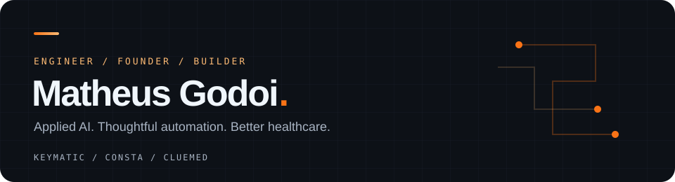

 

  
  
  
  

**I build software that connects people, information and the work between them.**

## About me

I'm Matheus, a biomedical engineer, founder and software builder based in São Paulo, Brazil. My work brings together **applied AI, business automation and healthcare** — from connecting business conversations to organizing clinical information and hospital operations.

I work across product, code and integrations, with a particular interest in LLMs, retrieval-augmented generation (RAG), AI agents and tools that make complex workflows easier to use.

## What I'm building

| Company | Focus | What I'm working on |
| :--- | :--- | :--- |
| **[Keymatic AI](https://www.keymatic.com.br/)** | Business automation & applied AI | WhatsApp and Instagram workflows, API integrations and AI-assisted customer service. |
| **Consta Care** | Hospital asset & maintenance management | Bringing equipment, contracts, maintenance schedules and documentation together. Currently in development. |
| **[ClueMed](https://cluemed.com.br/)** | Connected healthcare | Patient-owned health records, clinical workflows and AI-assisted document processing. |

## Areas I work in

- **Automation & integrations** — APIs, webhooks and workflows that connect business systems.
- **Applied AI** — LLMs, RAG, agents and document understanding, with human review where it matters.
- **Healthcare & biomedical engineering** — clinical information, hospital equipment and maintenance workflows.
- **Full-stack products** — web applications, desktop tools and the infrastructure behind them.
- **Developer tools & local AI** — MCP integrations, knowledge retrieval and self-hosted inference.

## Toolbox

  
  
  
  
  
  
  

**AI & systems:** LLMs · RAG · AI agents · Model Context Protocol (MCP) · Local inference · REST APIs · Webhooks

## Selected public projects

- **[SciMath MCP](https://github.com/matheusbgodoi/scimath-mcp)** — scientific computing with unit-aware calculations for engineering and science.
- **[Quotch](https://github.com/matheusbgodoi/quotch)** — AI provider quotas in the macOS notch, with support for multiple accounts.
- **[Clear Request](https://github.com/matheusbgodoi/clear-request)** — an agent skill that turns informal software requests into clear, scoped work.

## Let's connect

Interested in business automation, healthcare software or applied AI? Find me on **[LinkedIn](https://www.linkedin.com/in/matheusgodoi-engbio/)**.

---

  Biomedical engineering roots. Software builder mindset.

