<div align="center">
  <a href="https://github.com/matheusbgodoi">
    
  </a>
  <p>
    <a href="https://www.linkedin.com/in/matheusgodoi-engbio/"></a>
    <a href="https://www.keymatic.com.br/"></a>
    <a href="https://cluemed.com.br/"></a>
    
  </p>
  <p><strong>Biomedical engineer turned software builder.</strong><br />
  I build automation, applied AI and healthcare products in São Paulo, Brazil — from the first prototype to the integrations that keep it running.</p>
</div>

```ts
// src/profile.ts
import { BiomedicalEngineer, Founder, Builder } from "@matheus/core";

export const matheus = new Builder({
  name:   "Matheus Barboza de Godoi",
  base:   "São Paulo, BR",
  roots:  BiomedicalEngineer,            // where the mindset comes from
  roles:  [Founder, "full-stack", "applied-ai"],
  thesis: "connect people, information and the work between them",
});
```

```yaml
# building.yml — what is running right now

keymatic:                 # keymatic.com.br
  focus: business automation & applied AI
  shipping:
    - WhatsApp / Instagram workflows
    - API integrations
    - AI-assisted customer service

consta-care:              # in development
  focus: hospital asset & maintenance management
  shipping:
    - equipment registry
    - contracts & maintenance schedules
    - documentation in one place

cluemed:                  # cluemed.com.br
  focus: connected healthcare
  shipping:
    - patient-owned health records
    - clinical workflows
    - AI document processing
```


```toml
# toolbox.toml

[languages]
python     = "backends, pipelines, ML, MCP servers"
typescript = "web apps, agents, Electron tools"
swift      = "macOS / iOS utilities (quotch, personal-knowledge-mcp)"
sql        = "PostgreSQL"

[frameworks]
django   = "APIs and admin-heavy products"
react    = "dashboards and product UIs"
electron = "desktop tools"

[ai]
models    = ["Claude", "OpenAI", "local open-weights models"]
patterns  = ["RAG", "agents", "tool use", "Model Context Protocol"]
inference = ["RTX 3090 workstation", "Apple Silicon (MLX, Core ML)"]

[infra]
docker   = "self-hosted services and reproducible runtimes"
webhooks = "WhatsApp, Instagram and third-party APIs"
```


```console
$ ls --public ~/projects

scimath-mcp/        unit-aware scientific computing MCP server
quotch/             AI quotas in the macOS notch, several accounts each
clear-request/      agent skill: informal requests in, scoped work out
foto-macos/         instruction-based photo editing, 100% local
local-photo-ai-m5/  on-device natural photography for Apple Silicon

$ tree -L 1 ~/private        # ~30 repos, grouped
├── local-ai/        single-GPU inference stack, OpenAI-compatible API
├── mcp-servers/     WhatsApp, Instagram, Pinterest, media, knowledge
├── healthcare-ml/   medical document AI, echocardiography imaging
├── video-tooling/   agent-first video editor, captions, post engine
├── embedded/        Pico W remote control, Arduino, home IoT
└── talks/           "AI beyond ChatGPT", PUC-SP BME Week 2026
```

<div align="center">
  <sub>
    <a href="https://github.com/matheusbgodoi/scimath-mcp">scimath-mcp</a> ·
    <a href="https://github.com/matheusbgodoi/quotch">quotch</a> ·
    <a href="https://github.com/matheusbgodoi/clear-request">clear-request</a> ·
    <a href="https://github.com/matheusbgodoi/foto-macos">foto-macos</a> ·
    <a href="https://github.com/matheusbgodoi/local-photo-ai-m5">local-photo-ai-m5</a>
  </sub>
</div>


```sh
$ cat ~/contact.json
{
  "topics":   ["business automation", "healthcare software", "applied AI"],
  "linkedin": "https://www.linkedin.com/in/matheusgodoi-engbio/",
  "keymatic": "https://www.keymatic.com.br/",
  "cluemed":  "https://cluemed.com.br/",
  "status":   "building_"
}
```

<div align="center">
  
  <br />
  <sub><code>// biomedical engineering roots. software builder mindset.</code></sub>
</div>
