<div align="center">
  <a href="https://github.com/matheusbgodoi">
    
  </a>
  <p>
    <a href="https://www.linkedin.com/in/matheusgodoi-engbio/"></a>
    <a href="https://www.keymatic.com.br/"></a>
    <a href="https://cluemed.com.br/"></a>
    
  </p>
</div>

```ts
// src/profile.ts
import { BiomedicalEngineer, Founder, Builder } from "@matheus/core";

export const matheus = new Builder({
  name:   "Matheus Barboza de Godoi",
  base:   "São Paulo, BR",
  roots:  BiomedicalEngineer,                // where the mindset comes from
  roles:  [Founder, "full-stack", "applied-ai"],
  thesis: "software that connects people, information and the work between them",
});
```


```rust
// src/building.rs — what is running right now

pub enum Company { Keymatic, ConstaCare, ClueMed }

impl Company {
    pub fn focus(&self) -> &'static str {
        match self {
            Self::Keymatic   => "business automation & applied AI",          // keymatic.com.br
            Self::ConstaCare => "hospital asset & maintenance management",   // in development
            Self::ClueMed    => "connected healthcare: records + workflows", // cluemed.com.br
        }
    }

    pub fn shipping(&self) -> Vec<&'static str> {
        match self {
            Self::Keymatic   => vec!["WhatsApp / Instagram workflows", "API integrations", "AI-assisted customer service"],
            Self::ConstaCare => vec!["equipment registry", "contracts & maintenance schedules", "documentation in one place"],
            Self::ClueMed    => vec!["patient-owned health records", "clinical workflows", "AI document processing"],
        }
    }
}
```


```python
# src/areas.py
class Matheus(BiomedicalEngineer, SoftwareBuilder):
    """Product, code and integrations, end to end."""

    automation  = ["APIs", "webhooks", "workflows that connect business systems"]
    applied_ai  = ["LLMs", "RAG", "agents", "document understanding", "human review where it matters"]
    healthcare  = ["clinical information", "hospital equipment", "maintenance workflows"]
    products    = ["web apps", "desktop tools", "the infra behind them"]
    local_ai    = ["MCP servers", "knowledge retrieval", "self-hosted inference (RTX 3090 / Apple Silicon)"]

    def ship(self, problem: Problem) -> Product:
        return self.understand(problem).prototype().integrate().iterate()
```


```toml
# Cargo.toml — toolbox

[languages]
python     = "primary"
typescript = "primary"
swift      = "macOS / iOS tools"
sql        = "postgresql"

[frameworks]
django   = "*"
react    = "*"
electron = "*"

[ai]
llms            = ["OpenAI", "Anthropic", "local models"]
patterns        = ["RAG", "agents", "tool use", "Model Context Protocol"]
local-inference = ["RTX 3090", "Apple Silicon"]

[infra]
docker = "*"
rest   = "APIs + webhooks"
```


```console
$ ls --public ~/projects

scimath-mcp/        unit-aware scientific computing MCP server for engineering and science
quotch/             your AI quotas in the macOS notch — several accounts per provider
clear-request/      agent skill that turns informal software requests into clear, scoped work
foto-macos/         instruction-based photo editing, 100% local on Apple Silicon
local-photo-ai-m5/  on-device natural photography for Apple Silicon (CLI + MCP)
```
<div align="center">
  <sub>
    <a href="https://github.com/matheusbgodoi/scimath-mcp">scimath-mcp</a> ·
    <a href="https://github.com/matheusbgodoi/quotch">quotch</a> ·
    <a href="https://github.com/matheusbgodoi/clear-request">clear-request</a> ·
    <a href="https://github.com/matheusbgodoi/foto-macos">foto-macos</a> ·
    <a href="https://github.com/matheusbgodoi/local-photo-ai-m5">local-photo-ai-m5</a>
  </sub>
</div>


```sh
$ cat ~/contact.json
{
  "topics":   ["business automation", "healthcare software", "applied AI"],
  "linkedin": "https://www.linkedin.com/in/matheusgodoi-engbio/",
  "keymatic": "https://www.keymatic.com.br/",
  "cluemed":  "https://cluemed.com.br/",
  "status":   "building_"
}
```

<div align="center">
  <picture>
    <source media="(prefers-color-scheme: dark)" srcset="https://raw.githubusercontent.com/matheusbgodoi/matheusbgodoi/output/github-snake-dark.svg" />
    <source media="(prefers-color-scheme: light)" srcset="https://raw.githubusercontent.com/matheusbgodoi/matheusbgodoi/output/github-snake.svg" />
    
  </picture>
  <br />
  <sub><code>// biomedical engineering roots. software builder mindset.</code></sub>
</div>
